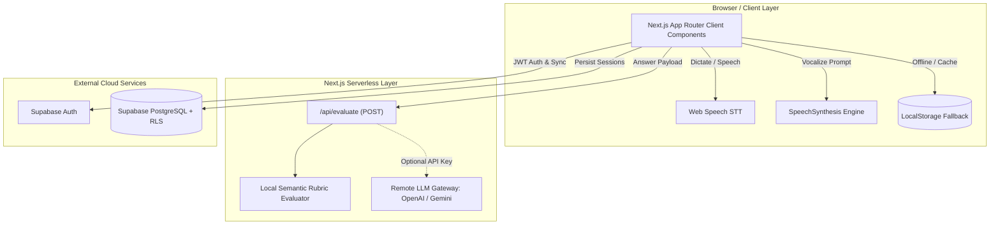
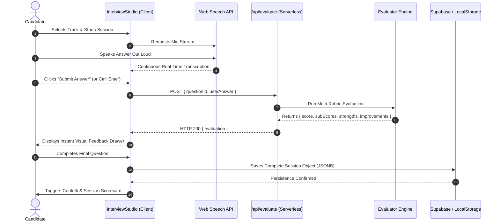

# System Architecture Document (ARCHITECTURE.md)

**Product Name:** PrepAI — AI-Powered Mock Interview Platform  
**Document Version:** 1.0.0  
**Target Phase:** Production Architecture & Coding Agent Specification  
**References:** [PRD.md](file:///d:/new%20project/ai-mock-interview/PRD.md) | [DESIGN.md](file:///d:/new%20project/ai-mock-interview/DESIGN.md)

---

## 1. Recommended Tech Stack & Architectural Rationale

To maintain maximum reliability, sub-second latency, and zero operational overhead, PrepAI follows a **Modern Monolithic Serverless Architecture** built entirely in TypeScript:



| Component | Choice | Architectural Rationale |
|---|---|---|
| **Framework** | **Next.js 15+ (App Router)** | Full-stack unified TypeScript runtime. Eliminates the need for a separate Node/Express backend container while supporting fast edge/serverless routes. |
| **Language** | **TypeScript 5 (Strict)** | Unified data contracts between questions, evaluations, database entities, and chart states. |
| **Styling** | **Tailwind CSS v4** | Zero-runtime CSS bundle, design-token consistency, responsive utility primitives. |
| **Voice Processing** | **Web Speech API (Browser Native)** | Zero latency, zero recurring API cost, zero audio streaming server infrastructure. |
| **Data Viz** | **Recharts** | Declarative SVG-based React charts that integrate with responsive glass containers. |
| **Auth & Database** | **Supabase (PostgreSQL + RLS)** | Instant Auth with JSONB support for session transcripts. Row-Level Security ensures multi-tenant data isolation. |
| **Hosting & CI/CD** | **Vercel** | Automated zero-config branch previews, instantaneous edge routing, and built-in SSL. |

---

## 2. Frontend / Backend Architecture

### 2.1 Frontend Architecture (Client-Side Orchestration)
The primary user workflow functions as a high-performance **Single Page Application (SPA)** managed through reactive client state:
- **Root State Coordinator (`src/app/page.tsx`):**
  - Manages active navigation tabs (`'setup' | 'interview' | 'dashboard' | 'history'`).
  - Holds active session parameters (`selectedRole`, `selectedLevel`, `selectedMode`).
  - Subscribes to live session collections using reactive hooks (`useSessions`).
- **Component Decoupling:**
  - `InterviewSetup.tsx`: Role and track configuration matrix.
  - `InterviewStudio.tsx`: Self-contained interactive state machine for active question timers, voice STT stream buffers, answer evaluations, and scorecard transitions.
  - `Dashboard.tsx`: Pure analytical visualization consuming pre-aggregated stats.
  - `SessionHistory.tsx`: Audit drawer and past session inspection modal.
  - `AuthGuard.tsx`: Protects private views and synchronizes authenticated sessions.

### 2.2 Backend Architecture (Serverless Route Handlers)
- **API Boundary (`src/app/api/evaluate/route.ts`):**
  - Handles `POST` requests containing `{ questionId, userAnswer }`.
  - Validates question metadata against the canonical question catalog.
  - Passes payload to the evaluation service layer (`src/lib/evaluator.ts`).
  - Returns structured `AnswerEvaluation` JSON with sub-second turnaround.

---

## 3. End-to-End Data Flow



---

## 4. Canonical Folder Structure

```
ai-mock-interview/
├── public/                     # Static media and logos
├── supabase/
│   └── schema.sql              # Profiles, interview_sessions, and RLS policies
├── src/
│   ├── app/
│   │   ├── api/
│   │   │   └── evaluate/
│   │   │       └── route.ts    # POST /api/evaluate endpoint
│   │   ├── dashboard/          # Standalone dashboard route (optional deep-link)
│   │   ├── login/              # Auth login & registration screen
│   │   ├── globals.css         # Design tokens, keyframes, and glassmorphism styles
│   │   ├── layout.tsx          # Root HTML layout, Inter font, metadata
│   │   └── page.tsx            # Main tab coordinator & SPA orchestrator
│   ├── components/
│   │   ├── AuthGuard.tsx       # Auth route wrapper & redirection logic
│   │   ├── Dashboard.tsx       # KPI cards, Recharts timeline & skill radar
│   │   ├── InterviewSetup.tsx  # Track, seniority, and mode selection grid
│   │   ├── InterviewStudio.tsx # Active question runner, STT/TTS & scorecard
│   │   ├── Navbar.tsx          # Sticky navigation, tab pills & user session
│   │   └── SessionHistory.tsx  # Historical review list and question audit modal
│   ├── data/
│   │   └── questions.ts        # Calibrated questions with keywords and ideal outlines
│   ├── lib/
│   │   ├── evaluator.ts        # Rubric scoring heuristics (Tech, Comm, Structure)
│   │   ├── session-storage.ts  # Dual-tier storage (Supabase sync + LocalStorage)
│   │   └── supabase.ts         # Supabase client factory & connection check
│   └── types/
│       └── interview.ts        # Canonical TypeScript types & domain interfaces
├── ARCHITECTURE.md             # This document
├── DESIGN.md                   # Visual system, UX, and components spec
├── PRD.md                      # Product requirements document
├── package.json
└── tsconfig.json
```

---

## 5. Database Interaction & Persistence Model

### 5.1 Dual-Tier Storage Strategy
To guarantee that the application functions seamlessly for new users without mandatory login hurdles while still providing cloud sync for returning candidates, PrepAI implements a **Dual-Tier Storage Strategy**:

1. **Local Tier (`localStorage`):**
   - Active Key: `'prepai_interview_sessions'`.
   - Guarantees instant writes with zero network latency.
   - Provides offline support and unauthenticated trial capabilities.
2. **Cloud Tier (`Supabase PostgreSQL`):**
   - Automatically synchronizes when an authenticated `user_id` is present.
   - Stores session metadata in indexed relational columns, while the complete array of evaluated questions is persisted in a queryable `JSONB` column (`session_data`).

### 5.2 Database Schema Reference
```sql
CREATE TABLE public.interview_sessions (
  id UUID DEFAULT gen_random_uuid() PRIMARY KEY,
  user_id UUID REFERENCES auth.users ON DELETE CASCADE,
  role TEXT NOT NULL,
  level TEXT NOT NULL,
  mode TEXT NOT NULL DEFAULT 'text',
  overall_score INTEGER,
  technical_accuracy_score INTEGER,
  communication_score INTEGER,
  structure_score INTEGER,
  summary_feedback TEXT,
  session_data JSONB,
  created_at TIMESTAMP WITH TIME ZONE DEFAULT TIMEZONE('utc'::text, NOW()) NOT NULL
);
```

---

## 6. Authentication & Authorization

- **Auth Provider:** Supabase Auth (Email + Password, Magic Link ready).
- **Session Handling:** JSON Web Tokens (JWT) stored securely in browser cookies and local client memory.
- **Authorization Enforcement:**
  - **Client-Side:** `<AuthGuard>` validates session existence; redirects unauthenticated visitors to `/login` if viewing protected views.
  - **Database-Side:** PostgreSQL Row Level Security (RLS) ensures candidates can only `SELECT`, `INSERT`, or `UPDATE` rows where `auth.uid() = user_id`.

---

## 7. AI & Evaluation Architecture

### 7.1 Multi-Rubric Evaluation Engine
The evaluation pipeline executes in `src/lib/evaluator.ts` and processes four analytical dimensions:

$$\text{Overall Score} = \text{Round}\big(0.45 \cdot S_{\text{tech}} + 0.30 \cdot S_{\text{comm}} + 0.25 \cdot S_{\text{struct}}\big)$$

1. **Technical Accuracy ($S_{\text{tech}}$):**
   - Extracts semantic tokens and performs case-insensitive intersection against `question.expectedKeywords`.
   - Calculates density score: $\min(100, \frac{\text{Keywords Found}}{\text{Total Keywords}} \times 100)$.
2. **Communication & Clarity ($S_{\text{comm}}$):**
   - Measures candidate answer length and vocabulary richness against calibrated seniority targets (Mid-level: 50–180 words).
   - Penalizes excessive filler phrases (*"um", "like", "basically", "you know"*).
3. **Structure & Framework ($S_{\text{struct}}$):**
   - For **Technical Roles:** Checks for problem-solving sequence (definition $\rightarrow$ trade-offs $\rightarrow$ edge cases).
   - For **Behavioral / HR Roles:** Checks for the **STAR framework** (Situation $\rightarrow$ Task $\rightarrow$ Action $\rightarrow$ Result).

### 7.2 Remote LLM Integration Extension (Future-Ready)
The evaluation endpoint is architected with a provider switch:
```
[User Answer] ──> [/api/evaluate]
                      │
           Is AI_API_KEY present?
                 /        \
              Yes          No
              /              \
  [LLM Gateway API]    [Local Rubric Heuristics]
```
If `AI_API_KEY` (OpenAI or Gemini) is set in the environment, `/api/evaluate` can dispatch a structured JSON prompt to the LLM; otherwise, it seamlessly executes the zero-cost local rubric evaluator.

---

## 8. Environment Configuration

The application requires only the following environment variables (defined in `.env.local`):

| Variable | Scope | Required | Description |
|---|---|---|---|
| `NEXT_PUBLIC_SUPABASE_URL` | Public (Client + Server) | Optional for local trial | Your Supabase Project URL |
| `NEXT_PUBLIC_SUPABASE_ANON_KEY` | Public (Client + Server) | Optional for local trial | Supabase Public Anonymous API Key |
| `AI_EVAL_API_KEY` | Private (Server-only) | Optional | Remote LLM API key for enhanced evaluations |
| `NEXT_PUBLIC_APP_URL` | Public | Optional | Base URL for redirection callbacks (`http://localhost:3000`) |

---

## 9. Error Handling & System Resilience

- **Speech Recognition Fallback:** If `webkitSpeechRecognition` is blocked or unavailable, the studio gracefully falls back to text mode with an explanatory alert without interrupting the interview.
- **Network Failure During Evaluation:** If the `/api/evaluate` request fails (e.g., connection drop), the client immediately falls back to running `evaluateAnswer()` directly in the browser runtime.
- **Storage Degrade Gracefully:** If Supabase is unreachable or RLS rejects an operation, the session is reliably written to `localStorage` and flagged for future sync.

---

## 10. Security Boundaries

1. **No Sensitive Data in Client Bundles:** No private API keys or database master keys are bundled in the client code.
2. **Input Sanitization:** All text inputs submitted to `/api/evaluate` are trimmed, length-limited ($\le 4000$ characters), and escaped before evaluation to prevent injection attacks.
3. **PostgreSQL RLS Hardening:** Zero global write or read permissions exist on `interview_sessions` without authenticated user validation.

---

## 11. Testing & Deployment Approach

### 11.1 Verification Strategy
- **Static Typing & Linting:** `npm run lint` and `npx tsc --noEmit` must pass with zero errors.
- **Evaluator Unit Verification:** Unit test suite covering `evaluateAnswer()` with synthetic short, empty, perfect, and filler-heavy answers.
- **Browser Audio Testing:** Smoke tests on Chromium and Safari to verify Web Speech API compatibility.

### 11.2 Deployment Pipeline (Vercel)
1. Push to `main` branch triggers automated Vercel build (`next build`).
2. Environment variables injected via Vercel Project Settings.
3. Edge CDN serves static assets and pre-rendered pages, while API routes run in lightweight Node.js serverless functions.
4. Custom domain configured with automatic SSL provisioning.
