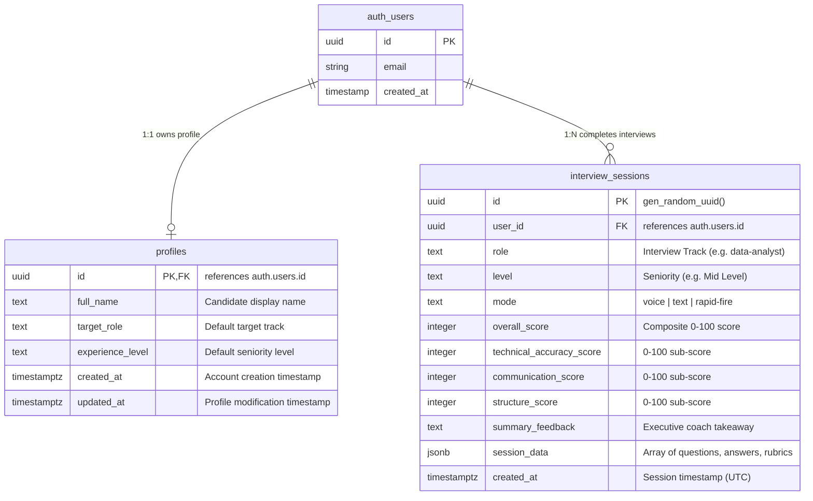

# Database Architecture & Schema Specification (DATABASE.md)

**Product Name:** PrepAI — AI-Powered Mock Interview Platform  
**Document Version:** 1.0.0  
**Target Engine:** PostgreSQL 15+ (Hosted on Supabase)  
**References:** [PRD.md](file:///d:/new%20project/ai-mock-interview/PRD.md) | [ARCHITECTURE.md](file:///d:/new%20project/ai-mock-interview/ARCHITECTURE.md)

---

## 1. Database Technology & Storage Strategy

- **Database Engine:** **PostgreSQL 15+** managed via Supabase.
- **Relational vs. Document Hybrid:**
  - Relational columns are used for user identity, query filters, search, aggregation, and score indexing (`role`, `level`, `mode`, `overall_score`, `created_at`).
  - Native `JSONB` document storage is utilized for granular question-by-question interview traces (`session_data`). This avoids brittle, multi-join tables for dynamic question answers, keyword audits, and rubric outlines while maintaining query speed.
- **Client Access Layer:** Supabase Client (`@supabase/supabase-js`) executing prepared queries over PostgREST with strict **Row-Level Security (RLS)** enforcement.

---

## 2. Entity-Relationship Diagram (ERD)



---

## 3. Tables, Columns & Types

### 3.1 Table: `public.profiles`
Stores candidate profile preferences and tracks default persona settings.

| Column | Type | Nullable | Default | Description |
|---|---|---|---|---|
| `id` | `UUID` | **NO** | *None* | Primary Key. References `auth.users(id)` ON DELETE CASCADE. |
| `full_name` | `TEXT` | YES | `NULL` | Candidate full name / display handle. |
| `target_role` | `TEXT` | **NO** | `'data-analyst'` | Default selected interview track. |
| `experience_level` | `TEXT` | **NO** | `'Entry Level'` | Default candidate seniority level. |
| `created_at` | `TIMESTAMPTZ` | **NO** | `TIMEZONE('utc'::text, NOW())` | Profile creation timestamp. |
| `updated_at` | `TIMESTAMPTZ` | **NO** | `TIMEZONE('utc'::text, NOW())` | Last profile update timestamp. |

### 3.2 Table: `public.interview_sessions`
Stores completed or in-progress mock interview sessions, composite scores, and deep interview telemetry.

| Column | Type | Nullable | Default | Description |
|---|---|---|---|---|
| `id` | `UUID` | **NO** | `gen_random_uuid()` | Primary Key. Unique session identifier. |
| `user_id` | `UUID` | **NO** | *None* | Foreign Key. References `auth.users(id)` ON DELETE CASCADE. |
| `role` | `TEXT` | **NO** | *None* | Track slug (`data-analyst`, `sql`, `python`, `hr`, etc.). |
| `level` | `TEXT` | **NO** | *None* | Seniority slug (`Intern / Student`, `Entry Level`, `Mid Level`, `Senior`, etc.). |
| `mode` | `TEXT` | **NO** | `'voice'` | Simulation mode (`voice`, `text`, `rapid-fire`, `star-deep-dive`, `pressure-test`). |
| `overall_score` | `INTEGER` | YES | `NULL` | Aggregate score (0–100). |
| `technical_accuracy_score` | `INTEGER` | YES | `NULL` | Technical rubric score (0–100). |
| `communication_score` | `INTEGER` | YES | `NULL` | Communication rubric score (0–100). |
| `structure_score` | `INTEGER` | YES | `NULL` | Structure & STAR rubric score (0–100). |
| `summary_feedback` | `TEXT` | YES | `NULL` | High-level takeaway generated upon session conclusion. |
| `session_data` | `JSONB` | **NO** | `'[]'::jsonb` | Complete transcript items array (schema detailed in §3.3). |
| `created_at` | `TIMESTAMPTZ` | **NO** | `TIMEZONE('utc'::text, NOW())` | Session completion timestamp (UTC). |

### 3.3 `session_data` JSONB Structure Contract
The `session_data` JSONB column adheres to the canonical `InterviewSessionItem[]` TypeScript interface:

```json
[
  {
    "questionId": "da-mid-01",
    "questionText": "How would you diagnose a sudden 15% drop in conversion rate?",
    "userAnswer": "First, I would verify the tracking pixel and data pipeline to ensure it is not a reporting glitch...",
    "timeSpentSeconds": 78,
    "evaluation": {
      "score": 88,
      "technicalAccuracyScore": 90,
      "communicationScore": 85,
      "structureScore": 89,
      "strengths": [
        "Immediately verified data integrity before jumping to business conclusions.",
        "Clear funnel segmentation by device and acquisition channel."
      ],
      "improvements": [
        "Could mention A/B test sample ratio mismatches.",
        "Quantify business impact on gross revenue."
      ],
      "suggestedAnswer": "A top-tier answer segments data into three pillars: Data Integrity, Internal Changes, and External Market Factors...",
      "keyKeywordsFound": ["tracking pixel", "funnel segmentation", "anomaly detection"],
      "missingKeywords": ["sample ratio mismatch", "cohort analysis"]
    }
  }
]
```

---

## 4. Constraints & Data Validation

1. **Score Range Checks:**
   ```sql
   ALTER TABLE public.interview_sessions
     ADD CONSTRAINT check_overall_score_range 
     CHECK (overall_score IS NULL OR (overall_score >= 0 AND overall_score <= 100));

   ALTER TABLE public.interview_sessions
     ADD CONSTRAINT check_tech_score_range 
     CHECK (technical_accuracy_score IS NULL OR (technical_accuracy_score >= 0 AND technical_accuracy_score <= 100));

   ALTER TABLE public.interview_sessions
     ADD CONSTRAINT check_comm_score_range 
     CHECK (communication_score IS NULL OR (communication_score >= 0 AND communication_score <= 100));

   ALTER TABLE public.interview_sessions
     ADD CONSTRAINT check_struct_score_range 
     CHECK (structure_score IS NULL OR (structure_score >= 0 AND structure_score <= 100));
   ```

2. **Valid Mode Check:**
   ```sql
   ALTER TABLE public.interview_sessions
     ADD CONSTRAINT check_valid_simulation_mode 
     CHECK (mode IN ('voice', 'text', 'rapid-fire', 'star-deep-dive', 'pressure-test'));
   ```

3. **User Reference Referential Integrity:**
   - Both `profiles.id` and `interview_sessions.user_id` enforce `ON DELETE CASCADE`. Deleting a user in `auth.users` cleanly purges all personal data and session history.

---

## 5. Indexes Based on Real Application Queries

The following indexes directly support the application's core user journeys:

```sql
-- 1. Accelerates loading candidate dashboard & session history in reverse chronological order
CREATE INDEX idx_interview_sessions_user_created 
  ON public.interview_sessions (user_id, created_at DESC);

-- 2. Accelerates role-filtered historical breakdown and readiness score computation
CREATE INDEX idx_interview_sessions_user_role 
  ON public.interview_sessions (user_id, role);

-- 3. GIN index for deep querying inside session transcripts (e.g., searching for past questions answered)
CREATE INDEX idx_interview_sessions_data_gin 
  ON public.interview_sessions USING GIN (session_data);
```

---

## 6. Ownership, Authorization & Row-Level Security (RLS)

PostgreSQL Row-Level Security is strictly enabled on all tables in the `public` schema. Unauthorized access is blocked at the database engine level.

```sql
-- Enable RLS
ALTER TABLE public.profiles ENABLE ROW LEVEL SECURITY;
ALTER TABLE public.interview_sessions ENABLE ROW LEVEL SECURITY;

-- Profiles Policies
CREATE POLICY "Users can view own profile"
  ON public.profiles FOR SELECT
  USING (auth.uid() = id);

CREATE POLICY "Users can update own profile"
  ON public.profiles FOR UPDATE
  USING (auth.uid() = id);

CREATE POLICY "Users can insert own profile"
  ON public.profiles FOR INSERT
  WITH CHECK (auth.uid() = id);

-- Interview Sessions Policies
CREATE POLICY "Users can view own interview sessions"
  ON public.interview_sessions FOR SELECT
  USING (auth.uid() = user_id);

CREATE POLICY "Users can insert own interview sessions"
  ON public.interview_sessions FOR INSERT
  WITH CHECK (auth.uid() = user_id);

CREATE POLICY "Users can delete own interview sessions"
  ON public.interview_sessions FOR DELETE
  USING (auth.uid() = user_id);
```

---

## 7. Sensitive Data Handling & Privacy

1. **No Plaintext Passwords:** Handled entirely by Supabase Auth with bcrypt hashing and salted tokens; no password hash ever touches `public` tables.
2. **Microphone Audio Privacy:** Voice data is transcribed ephemerally via browser Web Speech API. **Raw audio recordings are not stored or uploaded** to the database, minimizing storage requirements and privacy liability. Only final textual transcripts are retained.
3. **GDPR / Right to be Forgotten:** Cascading deletes (`ON DELETE CASCADE`) ensure that triggering user account deletion removes all interview records and scoring metrics in a single atomic transaction.

---

## 8. Migration, Triggers & Seed Strategy

### 8.1 Auto-Profile Creation Trigger
When a candidate signs up via Supabase Auth, a trigger automatically inserts a default corresponding record into `public.profiles`:

```sql
CREATE OR REPLACE FUNCTION public.handle_new_user()
RETURNS trigger AS $$
BEGIN
  INSERT INTO public.profiles (id, full_name, target_role, experience_level)
  VALUES (
    NEW.id,
    COALESCE(NEW.raw_user_meta_data->>'full_name', 'PrepAI Candidate'),
    'data-analyst',
    'Entry Level'
  );
  RETURN NEW;
END;
$$ LANGUAGE plpgsql SECURITY DEFINER;

CREATE OR REPLACE TRIGGER on_auth_user_created
  AFTER INSERT ON auth.users
  FOR EACH ROW EXECUTE FUNCTION public.handle_new_user();
```

### 8.2 Seed Strategy (Development / Test)
Static interview questions are maintained in the frontend codebase (`src/data/questions.ts`) to enable rapid version control and zero DB query overhead during the interview studio loop. Optional mock sessions can be seeded for demo accounts using the structure defined in §3.3.

---

## 9. Backup, Recovery & Maintenance

- **Automated Point-in-Time Recovery (PITR):** Handled via Supabase automated daily backups and write-ahead logs (WAL).
- **Client-Side Redundancy:** As specified in [ARCHITECTURE.md](file:///d:/new%20project/ai-mock-interview/ARCHITECTURE.md), any failed database write falls back into browser `localStorage`, ensuring zero loss of in-progress interview results even during network disconnection or database maintenance windows.
