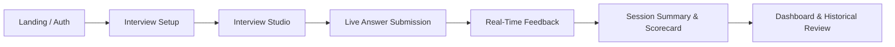

# Product Requirements Document (PRD)

**Product Name:** PrepAI — AI-Powered Mock Interview Platform  
**Document Version:** 1.0.0  
**Target Milestone:** MVP Launch to V1 Production  
**Document Status:** Source of Truth (Draft / Ready for Approval)

---

## 1. Problem, Value Proposition & Target Users

### 1.1 Problem Statement
Job seekers, career changers, and students preparing for technical and behavioral interviews face three major roadblocks:
1. **Lack of realistic practice environments:** Static LeetCode/flashcard platforms do not simulate real interviewer-candidate dialogue or time-constrained pressure.
2. **Delayed or nonexistent feedback:** Human mock interviews with mentors/coaches are costly ($100–$250/hr), hard to schedule, and inconsistent in evaluation rubrics.
3. **Unstructured answers under pressure:** Candidates struggle with applying structured answering methods (such as the STAR framework for behavioral interviews or systematic metric triage in data roles).

### 1.2 Value Proposition
PrepAI delivers an on-demand, multimodal (voice and text) mock interview studio that:
- Simulates realistic role-specific interview tracks with calibrated difficulty.
- Employs browser-native Speech-to-Text (STT) and AI Text-to-Speech (TTS) for conversational realism without expensive telephony plugins.
- Delivers instant rubric-based scoring across Technical Accuracy, Communication Clarity, and Answer Structure, accompanied by keyword gap analysis and ideal model answers.
- Visualizes readiness trends through an analytics dashboard to turn anxiety into measurable interview confidence.

### 1.3 Target Personas
- **Primary Persona A: The Aspiring Data / Tech Professional (Student / Entry-to-Mid Level)**
  - *Profile:* Recent graduate or transitioning engineer preparing for Data Analyst, SQL, or Python screens.
  - *Needs:* Practice live SQL/Python conceptual questions, refine communication, and get objective benchmark scores.
- **Primary Persona B: The Behavioral & Cross-Functional Candidate**
  - *Profile:* Professional interviewing for HR, Product Management, or leadership roles.
  - *Needs:* Structured practice adhering to the STAR method (Situation, Task, Action, Result) with actionable tips on story delivery and conciseness.
- **Secondary Persona: Experienced Hires (Senior / Staff)**
  - *Needs:* High-intensity rapid-fire and scenario triage practice under time pressure.

---

## 2. Assumptions & Flagged Decisions

### 2.1 Explicit Assumptions
- **Assumption 1 (Speech API):** Browser-native Web Speech API (`SpeechRecognition` / `webkitSpeechRecognition` & `speechSynthesis`) is sufficient for MVP voice interaction without introducing paid 3rd-party audio streaming APIs (like Whisper or ElevenLabs).
- **Assumption 2 (Evaluation Engine):** The MVP evaluation engine uses deterministic semantic rubric scoring (rule-based keyword, length, and heuristic pattern matching in `evaluator.ts`), with an architected bridge to plug in LLM API keys (e.g., OpenAI / Gemini) in the Next.js API route `/api/evaluate`.
- **Assumption 3 (Persistence Strategy):** Unauthenticated or offline users utilize local browser storage (`localStorage`) for zero-friction trial sessions, which syncs to Supabase PostgreSQL once authenticated.

### 2.2 Flagged Decisions Requiring Approval
> [!IMPORTANT]
> **DECISION 1 — LLM Provider Integration:** Should production interview evaluations strictly require a remote LLM API key (e.g., OpenAI `gpt-4o-mini` or Google `gemini-1.5-flash`), or should the platform maintain the fallback zero-cost heuristic evaluator as a toggleable tier?  
> **DECISION 2 — Question Generation vs. Static Question Bank:** For MVP, should interviews pull exclusively from the curated static catalog (`data/questions.ts`) or support dynamic AI-generated questions based on user-pasted job descriptions?

---

## 3. Core User Journeys & User Stories

### 3.1 Primary User Journeys

1. **Setup & Configuration Journey:** User enters platform $\rightarrow$ Selects target track (e.g., Data Analyst) $\rightarrow$ Selects seniority level $\rightarrow$ Picks simulation mode (Voice/Text) $\rightarrow$ Launches studio.
2. **Interactive Simulation Journey:** Candidate reads/hears question via TTS $\rightarrow$ Dictates or types response $\rightarrow$ Submits answer $\rightarrow$ Receives instantaneous breakdown on 3 rubrics + keyword audit $\rightarrow$ Proceeds to next question.
3. **Review & Analytics Journey:** Candidate concludes session $\rightarrow$ Views session scorecard with celebration feedback $\rightarrow$ Saves to session history $\rightarrow$ Explores radar chart and readiness metrics on Dashboard.

### 3.2 User Stories
- **US-01:** As a candidate, I want to select my specific target role and seniority level so that questions match the exact expectations of my upcoming interviews.
- **US-02:** As a candidate, I want to answer questions using my microphone with real-time speech transcription so that I can practice speaking out loud naturally.
- **US-03:** As a candidate, I want to see which critical industry keywords I included or omitted so that I can learn precise technical vocabulary.
- **US-04:** As a candidate, I want to review an "Ideal Answer Outline" after submitting my answer so that I understand what a top 5% candidate response looks like.
- **US-05:** As a candidate, I want to track my historical scores on a dashboard with skill radar charts so that I can measure my readiness and improvements over time.

---

## 4. Features & Functional Requirements

### 4.1 Track & Role Selection (Interview Setup)
- **FR-1.1:** System shall support 10 selectable career tracks:
  - *Active MVP Tracks:* Data Analyst, SQL Specialist, Python Developer, HR & Behavioral.
  - *Extended Tracks:* Full-Stack Dev, AI/ML Engineer, System Design, Product Manager, DevOps/Cloud, Cybersecurity.
- **FR-1.2:** System shall support 6 difficulty levels: *Intern / Student, Entry Level, Mid Level, Senior, Staff / Principal, Engineering Manager*.
- **FR-1.3:** System shall support 5 simulation modes:
  - `voice`: Browser STT + TTS enabled with live wave visualization.
  - `text`: Text editor with word counter and time tracker.
  - `rapid-fire`: Timed questions with auto-advance countdown.
  - `star-deep-dive`: Behavioral-focused questions enforcing Situation, Task, Action, Result checks.
  - `pressure-test`: Stricter time constraints and advanced scenario challenges.

### 4.2 Multimodal Interview Studio
- **FR-2.1 (Speech-to-Text):** Studio shall transcribe microphone input via Web Speech API in real-time and append text to the candidate's active answer input.
- **FR-2.2 (Text-to-Speech):** Studio shall provide an audio button to vocalize the current question text with pause/resume support.
- **FR-2.3 (Timer & Progress):** Studio shall display question step progress (e.g., `Question 2 of 4`) and an active session timer.
- **FR-2.4 (Hints):** Studio shall provide an expandable question hint if the candidate is blocked.
- **FR-2.5 (Navigation Controls):** Candidates may skip a question or prematurely complete/exit the session with state confirmation.

### 4.3 Rubric-Based Evaluation Engine
- **FR-3.1:** Answers must be evaluated across three 0–100 sub-scores:
  - **Technical Accuracy:** Match against expected terminology, conceptual accuracy, and syntax/metric definitions.
  - **Communication & Clarity:** Evaluation of brevity, completeness, filler words, and sentence clarity.
  - **Structure & Framework:** Adherence to problem-solving outlines (technical) or the STAR method (behavioral).
- **FR-3.2 (Composite Score):** Overall score = weighted aggregate: $\text{Round}(0.45 \times \text{Tech} + 0.30 \times \text{Communication} + 0.25 \times \text{Structure})$.
- **FR-3.3 (Feedback Breakdown):** Output must generate:
  - Minimum 2 specific strengths.
  - Minimum 2 actionable improvement areas.
  - List of detected keywords vs. missing critical keywords.
  - Model answer outline for post-submission learning.

### 4.4 Analytics Dashboard & Session History
- **FR-4.1 (KPI Summary Cards):** Total interviews completed, overall average score, cumulative practice hours, and computed "Readiness Score" (0–100%).
- **FR-4.2 (Visualizations):**
  - Score progression timeline across recent sessions (Line / Area chart).
  - Competency Radar Chart across Technical, Communication, Structure, Problem Solving, and Domain Depth.
- **FR-4.3 (History Audit Log):** Paginated/scrollable list of completed sessions with date, role tag, score badge, and modal view to inspect question-by-question answers and evaluations.

---

## 5. Non-Functional Requirements (NFRs)

### 5.1 Performance & Latency
- **NFR-1 (Evaluation Response Time):** Evaluation endpoint `/api/evaluate` must return results within `< 1.2 seconds` for heuristic evaluation, and `< 4.0 seconds` if routed through an LLM backend.
- **NFR-2 (Client-Side Rendering):** UI transitions between setup, studio, and dashboard tabs must render instantaneously without full page reloads (`< 100ms`).

### 5.2 Accessibility & Usability (a11y)
- **NFR-3:** Contrast ratios must meet WCAG 2.1 AA standards against the dark background theme (`#070d19`).
- **NFR-4:** All interactive controls (start, mic toggle, submit, exit) must be keyboard accessible and labeled with descriptive `aria-label` tags.

### 5.3 Reliability & Offline Resilience
- **NFR-5:** If Supabase connection fails or user is offline, mock session progress must persist to `localStorage` without data loss or user disruption.

### 5.4 Cross-Browser Compatibility
- **NFR-6:** Voice mode must gracefully detect browser support for `webkitSpeechRecognition`. On non-supported browsers (e.g., Firefox Desktop), UI must display a polite fallback notification prompting text mode.

---

## 6. Pages, Screens & Navigation Hierarchy

The application utilizes a single-page interactive App Router architecture with modal and route overlays:

| Screen / View | Route / State | Key Components & Purpose |
|---|---|---|
| **Authentication Screen** | `/login` | Supabase Auth (Sign-in / Sign-up) with email/password, session bypass guard, and password reset. |
| **Global Shell** | Root Layout | Navigation bar (Brand, Live Tab Switcher, User Profile/Logout, Theme Status) and footer. |
| **Setup View (Tab)** | `/?tab=setup` | Track cards grid, experience level pills, simulation mode selector, and "Launch Studio" CTA. |
| **Interview Studio View (Tab)** | `/?tab=interview` | Active Question card, Voice STT controls, Text response area, Word count, Real-Time Feedback drawer. |
| **Dashboard View (Tab)** | `/?tab=dashboard` | KPI Stat cards, Recharts Timeline, Skill Radar, Quick-start button, Performance benchmarks. |
| **Session History View (Tab)** | `/?tab=history` | Reverse-chronological session cards, score badges, question/answer expansion drawer, delete session actions. |

---

## 7. Roles, Permissions & Security

### 7.1 User Roles
- **Anonymous / Guest User:**
  - Can configure interviews and run sessions locally.
  - Data stored exclusively in browser `localStorage`.
- **Authenticated Candidate (Default Registered User):**
  - Full access to all tracks, voice/text modes, and history.
  - Remote cloud sync to Supabase database.
- **Admin (Future Scope):**
  - Ability to curate, edit, or delete questions in the central question bank.

### 7.2 Data Security & Row Level Security (RLS)
- Supabase tables `public.profiles` and `public.interview_sessions` enforce PostgreSQL RLS:
  - `auth.uid() = user_id` for all `SELECT`, `INSERT`, and `UPDATE` operations.
  - Zero cross-tenant data leakage.

---

## 8. Data Requirements & Schema

### 8.1 Database Entity Relationship (PostgreSQL / Supabase)

#### Table: `public.profiles`
- `id` (UUID, Primary Key, references `auth.users.id`)
- `full_name` (TEXT)
- `target_role` (TEXT, default: `'data-analyst'`)
- `experience_level` (TEXT, default: `'Entry Level'`)
- `created_at` (TIMESTAMPTZ, default: `NOW()`)

#### Table: `public.interview_sessions`
- `id` (UUID, Primary Key, default: `gen_random_uuid()`)
- `user_id` (UUID, references `auth.users.id`)
- `role` (TEXT, NOT NULL)
- `level` (TEXT, NOT NULL)
- `mode` (TEXT, NOT NULL)
- `overall_score` (INTEGER, 0–100)
- `technical_accuracy_score` (INTEGER, 0–100)
- `communication_score` (INTEGER, 0–100)
- `structure_score` (INTEGER, 0–100)
- `summary_feedback` (TEXT)
- `session_data` (JSONB) — Stores serialized `InterviewSessionItem[]` array (questions, user answers, granular scores, and strengths/improvements).
- `created_at` (TIMESTAMPTZ, default: `NOW()`)

---

## 9. Integrations

1. **Web Speech API:** Browser native `SpeechRecognition` (for STT audio dictation) and `SpeechSynthesis` (for question speech).
2. **Supabase Client (`@supabase/supabase-js`):** User authentication and session persistence.
3. **Recharts:** Responsive SVG data visualization for trends and radar graphs.
4. **Canvas Confetti:** Milestone celebration effects upon session completion.
5. **LLM Evaluation Gateway (Extensible):** Next.js API route `/api/evaluate` structured to accept OpenAI / Anthropic / Google Gemini API keys via environment variables (`AI_EVAL_API_KEY`).

---

## 10. UI States: Loading, Empty & Error Handling

### 10.1 Loading States
- **Studio Evaluating:** While `/api/evaluate` runs, the "Submit Answer" button transitions into an animated spinner with text: *"Analyzing answer & rubrics..."*, disabling duplicate submissions.
- **Voice Transcription Listening:** Pulsing blue radar wave indicator with dynamic *"Listening... Speak clearly into your mic"* prompt.

### 10.2 Empty States
- **Dashboard / History:** When `sessions.length === 0`:
  - Show friendly empty-state illustration/icon (`Inbox` / `Award`).
  - Headline: *"No interview sessions recorded yet"*.
  - Call-to-action: Primary button *"Start Your First Mock Interview"* navigating directly to Setup.

### 10.3 Error States
- **Microphone Denied:** If browser permission is blocked, render an inline amber banner: *"Microphone access blocked. Enable permissions in browser settings or switch to Text Mode."*
- **Empty Answer Submission:** If user submits `< 5 words`, highlight input with validation error: *"Please provide a more substantive response to enable AI evaluation."*
- **API Failure:** If `/api/evaluate` returns 500/network timeout, seamlessly invoke the local fallback heuristic evaluator in `evaluator.ts` so candidate practice is never blocked.

---

## 11. Scope Management & Success Criteria

### 11.1 In-Scope for MVP
- [x] Modern Dark Navy & Electric Blue interface with responsive layout.
- [x] 4 Core Tracks with calibrated question bank (Data Analyst, SQL, Python, HR).
- [x] Dual-mode studio: Text + Voice (Speech-to-Text & Text-to-Speech).
- [x] Multi-rubric scoring (Technical Accuracy, Communication, STAR structure).
- [x] Dynamic Strengths, Improvements, and Keyword gap analysis.
- [x] Session history persistence and detailed scorecard modal.
- [x] Interactive Recharts dashboard (score progression, readiness score, radar chart).
- [x] Supabase authentication and database sync with local storage fallback.

### 11.2 Out-of-Scope (Future Post-MVP Iterations)
- Video camera facial expression / eye contact analysis.
- Live collaborative code editor / execution sandbox (e.g., executing Python in Pyodide or live SQL against a Postgres container).
- Peer-to-peer human mock interview scheduling.
- Resume parsing to auto-generate customized mock interviews.

### 11.3 Success Criteria & Metrics
- **Session Completion Rate:** $\ge 80\%$ of initiated mock interviews reach completion.
- **Evaluation Turnaround:** $100\%$ of heuristic evaluations complete in $< 1.5\text{s}$.
- **Accuracy Perception:** Candidate self-reported satisfaction with AI feedback relevance $\ge 4.2 / 5.0$.
- **Zero Blocker Reliability:** $0$ unhandled client crashes during voice recording or score rendering.
